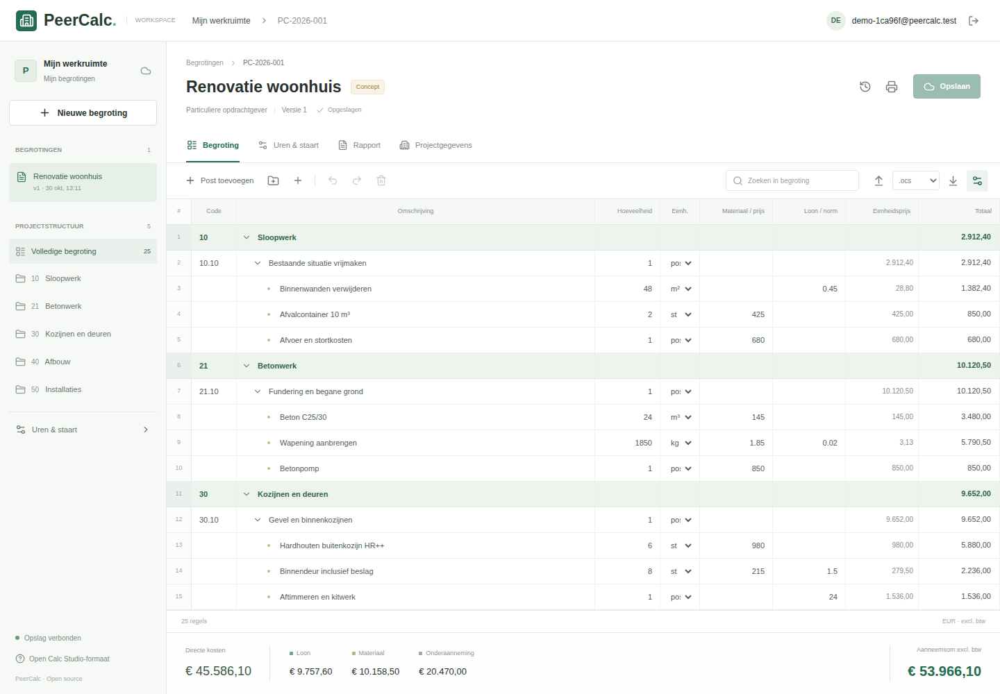

# PeerCalc

Open-source construction estimating for the browser, based on the Open Calc
Studio calculation model. Native `.ocs` and `.ifcCalc` documents remain portable;
authenticated storage adds append-only version history.



## Run Locally With Docker

The current delivery runs entirely locally, as requested. It does not publish
customer estimates or require a cloud account.

```sh
node scripts/configure-local.mjs
docker compose up --build -d --wait
```

Open <http://localhost:8788>. Sign in as `owner@peercalc.local` using
`PEERCALC_OWNER_PASSWORD` from the private `.env`, or register a separate local
account. Startup can take a minute while Keycloak initializes. Setup never
overwrites existing secrets. Keycloak's administrator is `admin`, with
`PEERCALC_ADMIN_PASSWORD` from the same file, at `/auth/admin/`.

Only the gateway is exposed, on loopback. Named Docker volumes retain documents,
every revision, identities, and sessions across restarts. `docker compose down`
preserves those volumes; **do not use `down -v` unless you intend to erase all
local data**. Keep `.env` together with volume backups. Changing an imported
realm's password in `.env` does not reset an existing user.

This configuration uses local HTTP, development-mode Keycloak, and unverified
registration emails. Ownership uses the signed OIDC subject, not email. It is
not a public production deployment. See [SECURITY.md](SECURITY.md).

## RHEL 9 / Rocky 9 Hosting

For a RHEL 9 or Rocky Linux 9 server with a public domain, use the separate HTTPS hosting setup:

```sh
sudo ./scripts/host-rhel9.sh calculatie.your-domain.nl
```

Point DNS to the server and make TCP 80/443 reachable first. See
[RHEL 9 hosting](docs/HOSTING_RHEL9.md) for installation, credentials, updates,
administration and backup requirements. This does not reuse local Docker data.
If another webserver already owns 80/443, the installer selects a free loopback
backend port starting at 8788 instead. Connect the existing HTTPS proxy to that
backend; the installer does not replace the running proxy or claim TLS is ready.

## Development

Requires Node.js 22.13 or newer.

```sh
cd web
npm ci
npm run build
node --import ./scripts/sites-env.mjs ./node_modules/wrangler/bin/wrangler.js d1 execute DB --local --config dist/server/wrangler.json --persist-to .wrangler/state --file drizzle/0000_medical_tomas.sql
npm run dev
```

The development server prints its URL and simulates sign-in on loopback. Use
Docker for real local authentication through Keycloak and OAuth2 Proxy. Both
Docker and optional Sites deployments provide trusted identity headers; never
expose the Worker directly to untrusted clients.

```sh
cd web
npm test
npm run typecheck
npm run build
npx playwright install chromium
npm run test:e2e
```

Playwright acceptance tests use the running Docker stack and private credentials
from `.env`. Login traces and videos are disabled. Unit tests need no Docker;
live converter tests are skipped unless their test URL/token is configured.

## Architecture

- React/Vinext Worker run locally with Wrangler in Docker; optional Sites hosting configuration is retained.
- Local Keycloak OIDC and OAuth2 Proxy sessions, with gateway-enforced identity and per-record ownership checks.
- D1-compatible SQLite stores project metadata, revision numbers, and immutable version references.
- R2-compatible local storage holds native documents and embedded assets in the persistent document volume.
- Compare-and-swap saves reject stale revisions instead of overwriting another tab's work.
- Restoring a version appends a new revision; existing versions are not rewritten.
- Genuine legacy WPCalc `.calc` export uses a separate Jackcess converter, not JSON renamed to `.calc`.

No cloud deployment is made by Docker Compose. The connected Sites project was
reserved before the local-only clarification and remains unpublished.

The application accepts documents up to 20 MiB and 20,000 estimate rows. Legacy
MDB imports are limited to 12 MiB to allow for the original database's base64
representation inside a native document. Complex files should be tested against
the original application before production use.

Deletion hides a project and retains its history and objects. Ambiguous database
failures can retain unreferenced objects rather than risk deleting committed data.
An operator-managed retention and garbage-collection policy is still required.

## Formats

Native files use the upstream JSON schema, with labor norms, hierarchy, tariffs,
staart charges, company data, and embedded sheets. Unknown fields are retained
when editing and exporting. Fields not exposed by the web editor remain in the
document; preservation does not mean every upstream feature is editable here.

Legacy `.calc` files are Access MDB databases. Imported source databases are
retained in the native document so the converter can preserve unedited tables
and columns. Legacy export requires the converter runtime and its server-side
configuration; see [converter/README.md](converter/README.md). Unsupported legacy
constructs fail explicitly rather than producing a partial estimate. Real MDB
readback is tested, but interoperability has not been certified in Windows
WPCalc/BasCalc. Native preservation is broader than the legacy mapping.

## Open Source

Licensed under LGPL-3.0-only. Reused Open Calc Studio source and fixtures retain
upstream notices. See [NOTICE.md](NOTICE.md), [LICENSE](LICENSE), and [COPYING](COPYING).
PeerCalc is an independent project, not an official OpenAEC Foundation product.

Contributions should include focused tests. Report security vulnerabilities
privately rather than publishing customer estimate files in issues.
